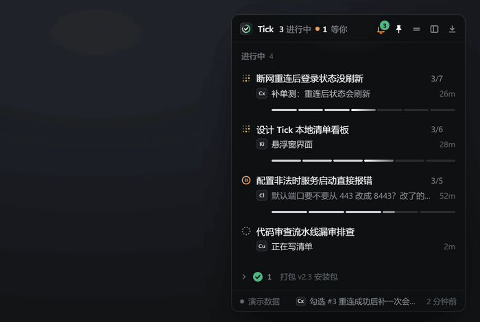
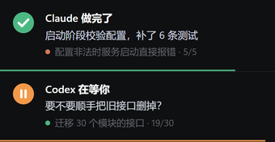
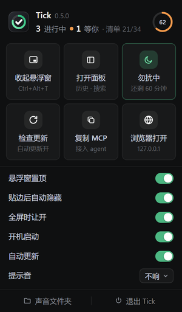
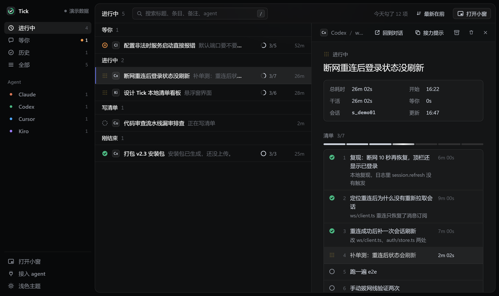

# Tick

Tick 记录本机 agent 的会话进度并发送通知，运行在 Windows 上。Claude Code、Codex、Cursor、Kiro 等 agent 开工时登记一份清单，做完一项勾一项；需要你拍板、卡住或做完时发通知。所有会话显示在一个置顶小窗里。一个对话对应一个会话，子 agent 挂在主会话下面。

<p align="center"></p>

整个程序是一个 `tick.exe`（Go，不依赖 cgo；本机 amd64 构建约 11 MB），包含：

- HTTP API、SSE 推送和 MCP 服务（`/mcp`），只监听 127.0.0.1；
- 给只能跑 shell 的 agent 用的命令行子命令；
- Windows 托盘、置顶悬浮窗、完整面板、右下角提醒卡（WebView2），提示音；
- 安装到各个 agent（`tick install`）、自动更新、崩溃自动重启。

## 快速开始

1. 从 [Releases](https://github.com/ZZray/agent-tick/releases/latest) 下载 `tick-windows-amd64.exe`（ARM 设备选 `arm64`）。
2. 在下载目录运行：

   ```powershell
   .\tick-windows-amd64.exe install --dry-run   # 先看会改哪些文件
   .\tick-windows-amd64.exe install             # 安装并启动
   ```

3. 重开 agent，在对话里说“用 tick 记录进度”，或者直接 `@tick`。

需要 Microsoft Edge WebView2 运行时，Windows 10/11 一般自带。

## 悬浮窗

- **会话列表：** 正在跑的排最上面，然后是等你和受阻的，再是还在写清单的，30 分钟没动静的放最后。同一档默认最新登记的在前；鼠标移到组头上会出现排序按钮，可以倒过来，面板里也有同一个开关。每行显示当前步骤、进度条和耗时，点开看清单。
- **长清单：** 超过 8 条时只显示当前这一步前 1 条、后 4 条，前后各折成一行（“前面 16 项已完成”“后面还有 8 项”），点一下展开全部。超过 12 条时进度条从分段换成一整条。
- **悬停能做的事：**
  - 在进度条上左右移动鼠标，条会变粗，提示框跟着显示那一步的内容、状态、耗时和备注；
  - 会话行右上角浮出快捷操作：回到对话、复制接力提示、在面板里打开，结束了的还能归档；
  - 清单里的一条：右边的耗时换成“复制这一条”和“跳过”（已完成或跳过的换成“恢复成待办”）。
- **刚结束：** 默认收成一行，开头是一个完成勾和数量，后面带几个标题做预览，点一下展开。鼠标移到组头上会出现归档按钮。窗口收起、贴边或收成胶囊时会自动再收回去。
- **通知抽屉：** 标题栏的铃铛上有未读数（绿色角标），有人等你时铃铛变橙。点铃铛，抽屉盖在悬浮窗上展开，窗口不变宽；Esc 或叉号关掉。
  - 最上面是“等你 / 受阻”卡片，可以回到对话、复制接力提示、展开清单，或标为知道了；
  - 下面是通知列表，分“未读”和“全部”。点一行标为已读，并在列表里定位那个会话；
  - 底部选提示音。
  - 新的“等你 / 受阻”到达时抽屉自动打开。
- **底栏：** 右边显示最近一条动态，比如“勾选 #3 补单测”和时间，点一下定位到那个会话。
- **胶囊和会话转盘：** 横线按钮或双击标题栏把悬浮窗收成一行，只显示最要紧的一件事：先是等你，然后是正在做的那一步。鼠标在胶囊上停 0.16 秒，会话沿半圆排开，贴着屏幕边那一侧。鼠标停在哪个气泡上，哪个就放大，两边的邻居跟着放大一点；左边换成它的标题、当前一步和进度。点气泡展开悬浮窗并打开那个会话。鼠标离开后气泡收回圆心，窗口缩回胶囊。
- **子 agent：** 子 agent 登记时带上主会话（`--parent` / `parent_session_id`），就显示在主会话下面，一个一行，点开看它自己的清单。
- **贴边：** 拖到屏幕上、下、左、右任一边缘附近松手，悬浮窗吸过去贴齐。鼠标离开 0.65 秒后收成一条贯穿整条屏幕边缘的细长条（6px 粗，上边缘就是屏幕顶端，下边缘贴在任务栏上沿）。每个任务一段，各用一种颜色，已完成的比例是亮色，里面有一点微光；等你的那一段是橙色。鼠标停在某一段上，鼠标旁边弹出这个任务的详情卡：状态和具体子步骤；看到卡片就算看过这个任务的通知，那一段的呼吸和流光（像 Ant Design 的 border beam，一道彗星状的彩色光沿着这一段跑）随即停下。离开长条卡片就消失；在某一段上右键可以把卡片钉住，之后慢慢看，再右键或点卡片关掉。点一下长条展开成完整面板，面板围着鼠标的位置长出来；之前选的是“收成一行”也一样给完整面板，收回去时再恢复成一行。托盘菜单里“贴边收成长条”取消勾选，就改回小标签（每个活跃会话一个进度环，最多 4 个，来消息时长成气泡）。
- **毛玻璃：** Windows 11 22H2 及以上，悬浮窗、提醒卡和托盘菜单背后是系统的 Acrylic 模糊，底色约八成不透明。更早的系统保持不透明。设置环境变量 `TICK_NO_GLASS=1` 可以关掉。
- **快捷键：** `Ctrl+Alt+T` 叫出或收起悬浮窗。被别的程序占用时不注册。
- **全屏时让开：** 前台是全屏游戏、视频或演示时自动隐藏，退出全屏后回来。

## 提醒卡、托盘和提示音

<p align="center">&nbsp;&nbsp;</p>

- **右下角提醒卡：** 不用 Windows 系统通知。勾了一项、做完、没做成、等你、卡住，以及 agent 主动发的提醒，都会在悬浮窗所在屏幕的右下角（任务栏上方）弹一张卡：大号状态图标、谁、做了什么、所属会话和进度。卡片底部一条倒计时，走完自动消失（勾一项 6 秒，做完 9 秒，等你 30 秒）；鼠标停在上面暂停，点卡片打开悬浮窗并定位到那个会话，点叉号关掉。同一个会话只占一张卡，“勾了一项”不会盖掉“等你”和“做完了”。卡片窗口置顶但不抢焦点，打字不会被打断。
- **托盘图标：** 深色方块里一圈进度环，弧长是所有进行中会话的总完成比例；有人在等你时环变橙；没有进行中的会话时环是满的。来提醒时图标闪几下。鼠标停在图标上显示几个在跑、几个在等、清单总进度。
- **托盘菜单：** 左键显示或收起悬浮窗；右键弹出一个宫格菜单：
  - 头部是版本、会话统计和总进度环；
  - 六个宫格：显示 / 收起悬浮窗、打开面板、勿扰 1 小时（开着时显示剩余分钟）、检查更新（有新版时变成“重启到新版”）、复制 MCP 地址、浏览器打开；
  - 开关列表：悬浮窗置顶、贴边后自动隐藏、全屏时让开、开机启动、自动更新，以及提示音选择；
  - 底栏：声音文件夹、退出 Tick。
  - 点到菜单外面或按 Esc 收起。宫格菜单打不开时会退回系统的文字菜单。
- **勿扰 1 小时：** 期间不弹提醒卡、不响提示音、不出气泡，悬浮窗照常记录。
- **提示音：** 默认不响。在托盘菜单或通知抽屉底部选一种，选中时试听一次。内置 8 种：清脆、清脆 · 单声、清脆 · 两下、轻铃、轻铃 · 三音、柔和、柔和 · 小三度、柔和 · 下行。想用自己的声音，把 `.wav` 放进 `%APPDATA%\Tick\sounds\`（菜单里的“声音文件夹”能直接打开）。

## 出错时

- **崩溃自动重启：** 桌面模式下 `tick.exe` 分成守护进程和干活的子进程。子进程崩溃、被结束或界面线程卡死时，守护进程按 1、2、5、10、30 秒的间隔重启它；10 分钟内崩溃 5 次就停下来弹窗提示，不再反复重启。崩溃时的错误输出（Go 的 panic 堆栈）追加到 `%APPDATA%\Tick\crash.log`，超过 1 MB 只留后一半。从托盘退出是正常退出，不会被重启。
- **页面卡住：** 悬浮窗页面每 15 秒向程序报一次心跳；窗口可见时 90 秒没收到（比如渲染进程崩了、页面白了），程序会重新加载页面。
- **数据：** 会话数据先写临时文件再改名替换，写到一半崩溃不会损坏 `sessions.json`。
## 完整面板

悬浮窗标题栏的面板按钮、会话里的“详情”、托盘“打开面板”，或者命令 `tick panel [会话]`，都会打开一个本地窗口。窗口无边框，标题栏由页面自己画：拖动、双击最大化，右上角有最小化、最大化和关闭；系统阴影、圆角、边缘缩放和贴靠照常可用。窗口会记住上次的大小和位置。

<p align="center"></p>

在面板里可以：

- 搜索标题、条目、备注、总结、目录和 agent，按 `/` 聚焦，已归档的也搜；
- 看历史：按天分组，组头写当天勾了几项、干活多久；
- 看“没动静”：说在跑、但 30 分钟没更新的会话单独放一组；
- 编辑：双击改标题和条目，点圆圈手动勾选或取消，底部“添加一项”，删除条目可以撤销，删除会话要点两次。

托盘里的“在浏览器里打开”会用浏览器打开同一个面板（`http://127.0.0.1:7357/`）。

## 安装与更新

```powershell
tick.exe install --dry-run   # 列出要做的事，不改文件
tick.exe install             # 复制程序、给本机已装的 agent 写 skill 和 MCP 配置，然后启动 Tick
tick.exe uninstall           # 撤掉 skill 和 MCP 配置（会话数据不删）
tick.exe update              # 检查并更新
tick.exe version             # 当前版本和更新源
```

`install` 不需要任何配置：

- 程序复制到 `%LOCALAPPDATA%\Programs\Tick\tick.exe`，所有配置都指向这里。旧版正在运行、文件被占用时沿用旧文件，提示你退出后再装或用 `tick update`。
- 只给本机装了的 agent 配，依据是配置目录是否存在：Claude Code、Codex、Kiro、Cursor、Gemini CLI，以及通用的 `~/.agents`。
- 每个 agent 得到两样东西：
  - **skill**（`skills/tick/SKILL.md`）：写明怎么登记清单、勾选、通知和派子 agent；
  - **MCP**：stdio 方式（`tick.exe mcp`），服务没开时自动拉起。Claude Code 通过 `claude mcp add --scope user` 添加，其余直接改配置文件。
- 改已有配置前先备份成 `*.bak-tick-时间`；已经配过 tick 的跳过；不是标准 JSON 的文件（比如带注释）不改，会提示你手动加。

自动更新：

- 更新源是本仓库的 GitHub Releases，校验 SHA256 通过才替换；校验不过时原程序不动。
- 启动 1 分钟后检查一次，之后每 12 小时检查一次。托盘里可以手动检查，也可以关掉自动更新。
- GitHub 接口被限流（未登录每个出口 IP 每小时 60 次，走代理时常见）时，改从 Releases 网页的跳转拿最新版本号，不影响更新。
- 新版下载好后，等到没有会话在跑时才重启：子进程用退出码通知守护进程，守护进程用新文件重新启动。
- 自己编译、没有设置更新源的版本不会自动更新。

## 接入 agent（手动）

用了 `tick install` 就不用手动配。想自己配，面板里的“接入 agent”可以复制下面这些配置，里面是本机的实际地址：

```text
Claude Code：  claude mcp add --transport http tick http://127.0.0.1:7357/mcp
Cursor / Kiro：{"mcpServers": {"tick": {"url": "http://127.0.0.1:7357/mcp"}}}
Codex：        [mcp_servers.tick]
               url = "http://127.0.0.1:7357/mcp"
只支持 stdio： {"mcpServers": {"tick": {"command": "C:\\path\\to\\tick.exe", "args": ["mcp"]}}}
```

MCP 初始化时会把用法交给 agent：开工写清单、逐条勾选、需要你时通知、做完写总结。agent 名称从客户端信息自动识别。完整约定见 [AGENT_PROTOCOL.md](AGENT_PROTOCOL.md)，服务启动后也能从 `/protocol` 读取，其中有不用 MCP 时的 HTTP 接口。

## 命令行

没接 MCP、只能跑 shell 的 agent 用同一个 `tick.exe`。中文参数直接传，不经过 JSON，所以不会遇到 PowerShell 5.1 的编码乱码：

```powershell
$sid = tick.exe start "修复重连后状态不刷新" "复现" "修复" "编译验证" --agent codex --ext <对话ID> | Select-Object -First 1
tick.exe doing $sid 1
tick.exe done $sid 1 --note "本机复现，日志键 session.refresh"
tick.exe wait $sid --note "要推送到 dev1 吗？"
tick.exe finish $sid --summary "改了 2 个文件，单测 3/3，未上真机"
# 派子 agent 时把 $sid 交给它，它登记时加 --parent $sid
```

`start` 输出的第一行是会话 ID；其他写操作只输出一行（会话、状态、进度），要看完整清单用 `tick show`。`tick.exe` 是窗口程序，PowerShell 里要把输出接到管道（`| Select-Object -First 1`、`| Out-String`）才拿得到，直接写 `$x = tick.exe …` 或 `(tick.exe …)[0]` 拿到的是空值。全部子命令见 `tick.exe help`。退出码：0 成功，1 用法或接口错误，2 连不上 Tick。

## 计时口径

- **条目耗时：** 从 doing 到 done 的累计时间；会话处于等你、受阻或已结束时暂停。
- **会话总耗时：** 从登记到结束。结束后同一对话又来了新任务、会话被重新打开时，中间空着的时间不算。
- **等你：** 处于 waiting / blocked 的累计时间。
- **干活：** 总耗时减去等你。

## 安全

- 只绑定 127.0.0.1，并校验 `Host` 头，防 DNS rebinding。
- 写请求必须是 `application/json`；带 `Origin` 时必须是本机地址，防别的网页跨站提交。
- **没有鉴权**：本机任何进程都能读写会话和发通知。不要在清单和通知里写密钥。
- 链接只接受 `scheme://`，拒绝 `javascript:`、`data:`、`file:` 等；打开链接时宿主侧会再查一遍。
- 不写系统通知相关的注册表。勾选“开机启动”会写 `HKCU\...\Run\Tick`。

## 数据与参数

| 参数 / 环境变量 | 默认值 | 作用 |
|---|---|---|
| `-port` / `TICK_PORT` | 7357 | 端口（命令行子命令和 `tick mcp` 只认 `TICK_PORT`） |
| `-data` / `TICK_DATA_DIR` | `%APPDATA%\Tick` | 数据目录：会话 `sessions.json`、窗口设置 `desktop.json`、日志 `tick.log`、自定义提示音 `sounds\` |
| `-headless` | 关 | 只开服务，不开托盘和窗口，在浏览器里看 |

再次运行 `tick.exe` 不会开第二份，只会把已有的悬浮窗叫出来。

## 开发

```powershell
$env:CGO_ENABLED = '0'
go build -ldflags "-H windowsgui -s -w" -o tick.exe .
go vet ./...
go test ./...
```

测试覆盖：
- 会话新建与重新关联；计时（等待暂停、重开不计空档）；重发清单保留状态；删除；子会话；
- 通知生成与自动已读、agent 主动通知；
- 输入校验，Host / Origin / Content-Type 拦截；SSE 推送；持久化；MCP 全流程；
- 安装时的配置合并；
- 自动更新：版本比较、校验通过才替换（校验不过或缺资产时原文件不动）、GitHub API 限流时的网页兜底；
- 各种状态和尺寸的图标绘制。

托盘、悬浮窗、提醒卡、托盘菜单和提示音没有自动化测试，靠实机运行检查。

推送 `vX.Y.Z` 标签会触发 `.github/workflows/release.yml`：测试、编译 amd64 和 arm64、生成 `SHA256SUMS` 并发布到 Releases。

## 许可证

[MIT](LICENSE)
